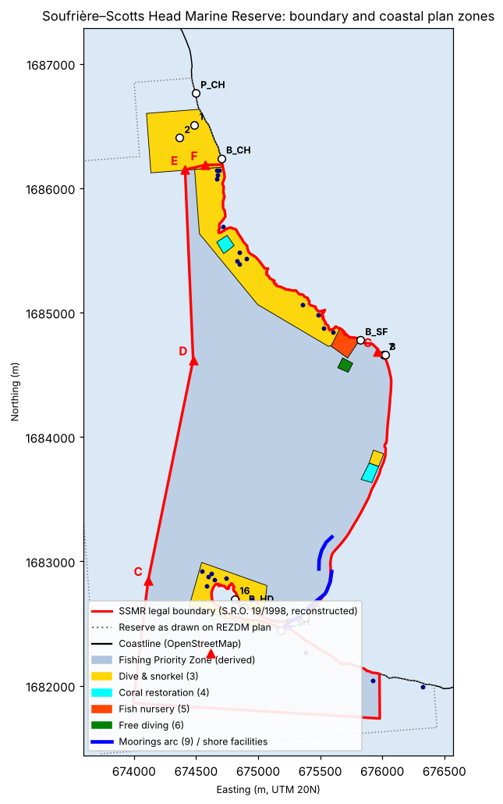

# Soufrière–Scotts Head Marine Reserve: Turning the Coastal Plan into GIS Boundaries

*Methods note. Oceans Forward, November 2026. Dataset: ENV-GIS-002 ([dataset README](README.md)).*

## 1. Purpose

The REZDM Coastal Plan for Soufrière, Scotts Head and Champagne (Fondation Daniel Langlois, 2018–2019) exists only as a map image. This note records how we turned that image into GIS layers: the reserve boundary and the planned use zones (dive and snorkel areas, coral restoration, fish nursery, free diving, moorings and shore facilities). With these layers the plan can be overlaid with field data, measured, and shared.

## 2. Source data

| Source                                                                 | What we used                                                      | Access                                     |
|------------------------------------------------------------------------|-------------------------------------------------------------------|--------------------------------------------|
| REZDM Coastal Plan image (© Fondation Daniel Langlois, 2018–19)        | Zone layout, legend numbering, schematic reserve outline          | Image held by Oceans Forward               |
| Fisheries (Soufriere/Scotts Head Marine Reserve) Order 1998, S.R.O. 19 | Gazetted boundary points A–K and the written boundary description | FAOLEX (faolex.fao.org, dmi87093.pdf)      |
| World Database on Protected Areas (WDPA), site 37117                   | Official reserve polygon, used for comparison                     | Protected Planet / UNEP-WCMC WDPA service  |
| OpenStreetMap                                                          | Coastline, piers, place names                                     | Overpass API (ODbL), extracted 15 Nov 2026 |

## 3. Workflow

### 3.1 Official reserve polygon (WDPA)

We downloaded the reserve polygon (WDPA ID 37117) from the UNEP-WCMC WDPA map service. WDPA lists it as a Marine Reserve, IUCN category IV, designated in 1998, with a reported area of 5.35 km². The polygon covers 494.8 ha and runs only from Scotts Head north to Soufrière. **It leaves out the stretch from Soufrière to Anse Bateau (Champagne) that the 1998 Order includes.**

### 3.2 Reconstruction of the legal boundary (S.R.O. 19 of 1998)

We read the Schedule of the 1998 Order from the scanned gazette. The seaward boundary runs A → B → C → D → E, then E → F, and the landward limit follows the main road and ridge top. We used the gazetted coordinates for points C, D, E and F as published. Two problems came up:

- **Points A and B are misprinted.** Both are printed at 61°21.57'W, which falls on land, about 2 km east of Scotts Head. For this southern edge we used the WDPA line instead.
- **Point K plots about 150 m offshore** of the shoreline position the Order describes. This suggests the 1998 coordinates were read from a chart, not taken by GPS.

We closed the polygon on the landward side along the OpenStreetMap coastline. The reconstructed marine area is **552.7 ha**, within about 3% of the reported 534.5 ha. The legal reserve also takes in a strip of coastal land up to the main road. That strip is not in the polygon.

### 3.3 Georeferencing the plan image

1.  **Coastline extraction.** We classified the plan image's pixels into sea (the blue background and the yellow overlays) and land (the satellite image). We cleaned the mask with morphological opening and traced the land/sea edge as a contour of about 3,200 points.
2.  **Matching to the real coastline.** We fitted that contour to the OpenStreetMap coastline in WGS 84 / UTM zone 20N (EPSG:32620). The fit used an affine transform found by trimmed iterative closest point (ICP), which keeps the closest 75% of matches each iteration so that label circles and coloured boxes do not distort it. Three rough tie points (Soufrière jetty, Pointe Michel, Scotts Head village) set the starting position.
3.  **Fit quality.** The median residual between the plan's coastline and the OSM coastline is **9 m** and the 75th percentile is **19 m**. A 2nd-order polynomial improved this only slightly, so we kept the simpler affine transform. The plan works out to about 4.3 m per pixel, rotated about 4° from north.
4.  We exported the georeferenced image as a north-up GeoTIFF at 4 m resolution so it can be checked in QGIS.

### 3.4 Digitizing the plan features

We read zone corners from gridded, zoomed crops of the plan and converted them to UTM 20N with the fitted transform. Then:

- Every polygon was clipped to the sea using the OSM coastline, so zones next to the shore follow the real coast and not the drawn edge.
- The two jetties (7 and 10) use OSM pier geometry, not the plan's leader lines.
- Beach points were snapped to the nearest coastline.
- The 23 small blue dots on the plan are not in its legend. We captured them as "probable moorings (unverified)".

| ID                    | Feature                                                               | Type    | Area (ha) |
|-----------------------|-----------------------------------------------------------------------|---------|-----------|
| 1                     | Underwater Statue Park / Champagne zone                               | Polygon | 25.0      |
| 3a                    | Dive and snorkel area, Champagne to Soufrière                         | Polygon | 40.0      |
| 3b                    | Dive and snorkel area, south of Soufrière                             | Polygon | 0.9       |
| 3c                    | Dive and snorkel area, Scotts Head                                    | Polygon | 15.3      |
| 4a / 4b               | Coral reef restoration zones (north / south)                          | Polygon | 1.1 / 1.2 |
| 5                     | Soufrière Fish Nursery                                                | Polygon | 2.7       |
| 6                     | Soufrière Free Diving Zone                                            | Polygon | 0.8       |
| FPZ                   | Fishing Priority Zone (derived, see 3.5)                              | Polygon | 492.1     |
| 9                     | Yacht moorings                                                        | Line    | –         |
| 11, 12, 15            | Scotts Head shore facilities                                          | Line    | –         |
| P, B, 2, 7, 8, 10, 16 | Parking, beaches, shipwreck, jetties, vendor facilities, fort lookout | Point   | –         |

### 3.5 Fishing Priority Zone

The plan labels the Fishing Priority Zone but draws no boundary for it. We defined it as the reconstructed 1998 reserve minus zones 1, 3, 4, 5 and 6. **This is our interpretation, not part of the plan**, and the layers flag it as such.

### 3.6 Outputs and publication

- **GeoPackage** (UTM 20N) and **GeoJSON** (WGS 84) files, with these layers: *ssmr_boundary_legal_1998*, *sro1998_boundary_points*, *plan_zones*, *plan_lines*, *plan_points* and *coastline_osm*.
- These were published to the Dominica Data Repository as **ENV-GIS-002** (merged 16 Nov 2026), with a dataset README and a preview map.
- We also built a **Google Earth KML** with styled, switchable layers for exploring the data. The first KMZ failed to import into Google Earth Web with a "style doesn't exist" error, because the KML library had put style definitions inside folders under numeric IDs. We rewrote the KML with all styles defined once at the top of the document, under plain-text IDs.

## 4. Accuracy and caveats

- The plan is a schematic concept drawing, not a survey. Expect 10–30 m error on drawn shapes and more on points placed from labels. **These layers are not legal or survey boundaries.**
- About 98% of zone 1 (Champagne / statue park) lies north of the 1998 boundary, which ends at Anse Bateau. The plan appears to propose extending the reserve north.
- Zones 3a and 4a are entirely outside the WDPA polygon but inside the 1998 boundary. This is another sign that the WDPA polygon is incomplete.
- Mooring, restoration and nursery positions should be replaced with field GPS fixes when they are available.

## 5. Licensing decisions

- The published dataset is under **ODbL 1.0**, not the repository's usual CC BY 4.0. Every layer is clipped to OpenStreetMap data, which makes the dataset a derivative database under OpenStreetMap's license.
- The **WDPA polygon is not redistributed**, because the WDPA terms of use do not allow it. The dataset README links to Protected Planet instead.
- The **plan image and its georeferenced GeoTIFF are not published**, because they are © Fondation Daniel Langlois / REZDM. Oceans Forward holds them and shares them on request. Before wider use, confirm with REZDM that publishing the traced zones is acceptable.

## 6. Suggested next steps

1.  Ask the Fisheries Division for the correct coordinates of points A and B, or for any official boundary shapefile.
2.  GPS the mooring buoys, restoration frames and nursery, and replace the digitized versions.
3.  Report the gap in the WDPA polygon (Soufrière to Anse Bateau) to UNEP-WCMC so the global record can be corrected.
4.  Confirm with REZDM which plan zones are adopted and which are still proposals.

## 7. Tools

Python (GeoPandas, Shapely, pyproj, scikit-image, SciPy, rasterio, matplotlib); OpenStreetMap Overpass API; UNEP-WCMC WDPA REST service; QGIS-compatible GeoPackage and GeoTIFF outputs.

## References

- Commonwealth of Dominica (1998). Fisheries (Soufriere/Scotts Head Marine Reserve) Order 1998, S.R.O. 19 of 1998. FAOLEX: https://faolex.fao.org/docs/pdf/dmi87093.pdf
- UNEP-WCMC and IUCN. Protected Planet: Soufriere/Scott's Head (WDPA ID 37117). https://www.protectedplanet.net/37117
- OpenStreetMap contributors. Coastline data, ODbL. https://www.openstreetmap.org
- Fondation Daniel Langlois / REZDM (2018–2019). Coastal Plan – Soufrière \| Scotts Head \| Champagne.
- Levenson JJ (2026). Oceans Forward Dominica Data Repository, v1.0. Zenodo. https://doi.org/10.5281/zenodo.24202525
