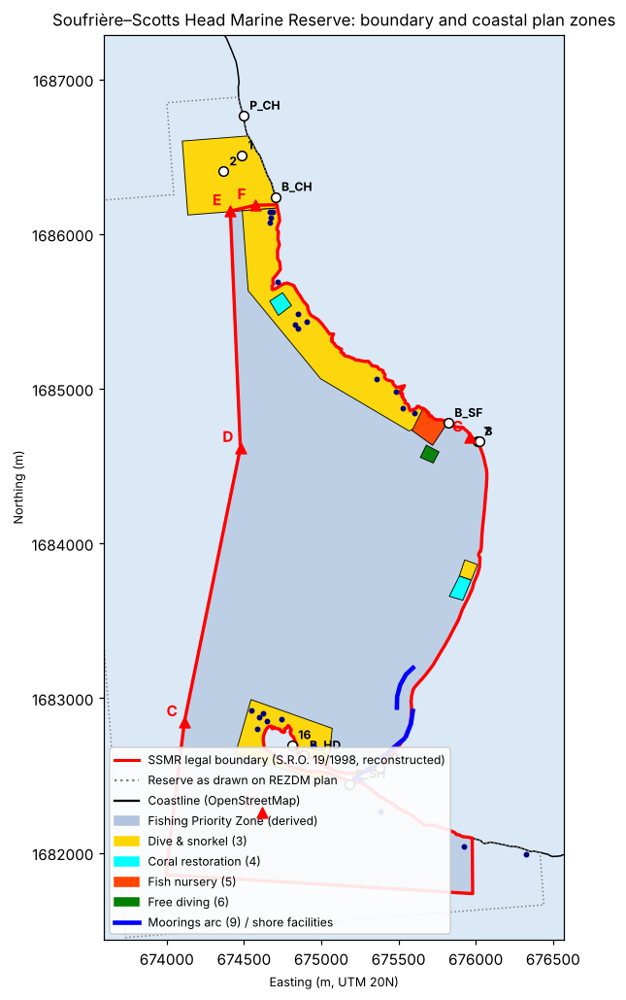

# Soufrière–Scotts Head Marine Reserve: boundary and coastal plan zones

**Catalog ID:** ENV-GIS-002
**Access:** Public
**License:** ODbL 1.0 (see below). This replaces the repository's default CC BY 4.0.
**Contact:** J. Jacob Levenson, Oceans Forward, Jlevenson@oceansforward.org

## What this is
GIS layers for the Soufrière–Scotts Head Marine Reserve (SSMR) in southwest Dominica:

- a reserve boundary rebuilt from the 1998 Order that created the reserve
- the use zones from the REZDM Coastal Plan for Soufrière, Scotts Head and Champagne (Fondation Daniel Langlois, 2018–2019), digitized from the plan image: dive and snorkel areas, coral restoration zones, fish nursery, free-diving zone, moorings and shore facilities

## Coverage
- **When:** boundary as gazetted 18 June 1998; plan zones as drawn in 2018–2019
- **Where:** Soufrière and Scotts Head Bay north to Anse Bateau and Champagne, Parish of St. Mark

## How it was made
1. **Legal boundary.** Points C, D, E and F come from the Fisheries (Soufriere/Scotts Head Marine Reserve) Order 1998, S.R.O. 19, Schedule. The gazette prints points A and B at 61°21.57'W, which is on land, so it is a misprint. The southern edge (A–B) therefore follows the WDPA interpretation of that edge. The landward edge here is the OpenStreetMap coastline. The legal landward limit is the Soufrière–Scotts Head main road and ridge top, so the reserve also includes a coastal fringe of land that is not in this polygon. Area: 552.7 ha, against 534.5 ha reported.
2. **Georeferencing the plan.** The land/sea edge was extracted automatically from the plan image. It was then fitted to the OpenStreetMap coastline with an affine transform (trimmed iterative closest point over about 3,200 edge points). Residuals: median 9 m, 75th percentile 19 m.
3. **Digitizing.** Zone vertices were traced on the georeferenced image in UTM 20N. Every zone is clipped to the sea using the OSM coastline. The two jetties use OSM pier geometry, and the beaches are snapped to the coastline.

## Files
| File | What it contains |
|------|------------------|
| `ssmr_coastal_plan.gpkg` | All layers in one GeoPackage, EPSG:32620 (WGS 84 / UTM 20N) |
| `geojson/*.geojson` | The same layers as GeoJSON, EPSG:4326 |
| `preview.png` | Quick-look map |

| Layer | Geometry | Contents |
|-------|----------|----------|
| `ssmr_boundary_legal_1998` | Polygon | Reserve boundary rebuilt from S.R.O. 19 of 1998 |
| `sro1998_boundary_points` | Point | Gazetted points C, D, E, F, G and K |
| `plan_zones` | Polygon | Zones 1, 3a–3c, 4a–4b, 5 and 6, the reserve as drawn on the plan (`SSMR_plan`), and the Fishing Priority Zone (`FPZ`) |
| `plan_lines` | Line | Yacht moorings arc (9), shore facilities (11, 12, 15), Scotts Head beach |
| `plan_points` | Point | Parking, beaches, statue park (1), shipwreck (2), jetties (7, 10), vendor facilities (8), fort lookout (16), and 23 unlabelled plan dots |
| `coastline_osm` | Line | OpenStreetMap coastline used for fitting and clipping |

## Columns
| Column | Meaning | Units |
|--------|---------|-------|
| `zone_id` | Number from the plan legend (e.g. `3a`, `5`) or a code (`FPZ`, `B_SH`, `dot01`) | |
| `name` | Name from the plan legend | |
| `category` | `dive_snorkel`, `coral_restoration`, `fish_nursery`, `free_diving`, `fishing_priority`, `reserve_schematic`, `moorings`, `shore_facility`, `beach`, `jetty`, `parking`, `dive_site`, `lookout` or `mooring_unverified` | |
| `source` | Where the geometry came from | |
| `note` | Caveats for that feature | |
| `point`, `lon`, `lat` | Gazetted point letter and its coordinates (`sro1998_boundary_points` only) | decimal degrees |

## Quality control and known problems
- The plan is a schematic concept drawing, not a survey. Expect 10–30 m error on drawn shapes and more on points placed from labels. **Do not use these layers as legal or survey boundaries.**
- **The Fishing Priority Zone is an interpretation.** The plan labels it but draws no boundary, so `FPZ` is the legal reserve minus zones 1, 3, 4, 5 and 6.
- Zone 1 (Champagne and the statue park) lies about 98% outside the 1998 boundary, which ends at Anse Bateau. The plan appears to extend the reserve north.
- Gazetted point K plots about 150 m offshore of where the Order describes it. The 1998 coordinates were probably read from a chart, not GPS.
- The 23 blue dots on the plan are not in its legend. They are probably dive and snorkel moorings, but this has not been verified.
- Mooring, restoration and nursery geometry should be replaced with field GPS positions when available.
- The WDPA polygon for the reserve (WDPA ID 37117) is not included because the WDPA terms of use do not allow redistribution. Get it from [Protected Planet](https://www.protectedplanet.net/37117). Note that it ends at Soufrière and leaves out the stretch from Soufrière to Anse Bateau.

## Where the raw data lives
The source plan image and its georeferenced GeoTIFF are © Fondation Daniel Langlois / REZDM, so they are not published here. They are available from Oceans Forward on request.

## License
Every layer is clipped to, or snapped to, OpenStreetMap data, so this dataset is a derivative database and is released under the [Open Database License (ODbL) 1.0](https://opendatacommons.org/licenses/odbl/1-0/). Coastline © OpenStreetMap contributors. Zone layouts come from the REZDM Coastal Plan (Fondation Daniel Langlois, 2018–2019). The boundary comes from S.R.O. 19 of 1998, Commonwealth of Dominica.

## How to cite
Oceans Forward (2026). Soufrière–Scotts Head Marine Reserve: boundary and coastal plan zones. Oceans Forward Dominica Data Repository. https://doi.org/10.5281/zenodo.24202525

## Change log
- 2026-11-16 First version.
